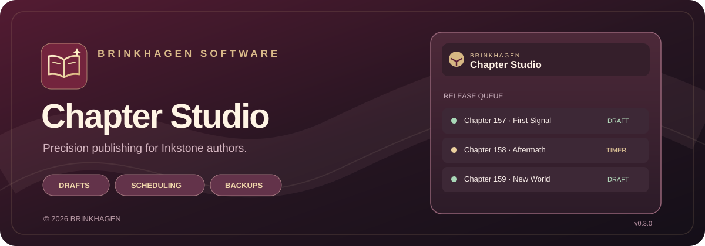
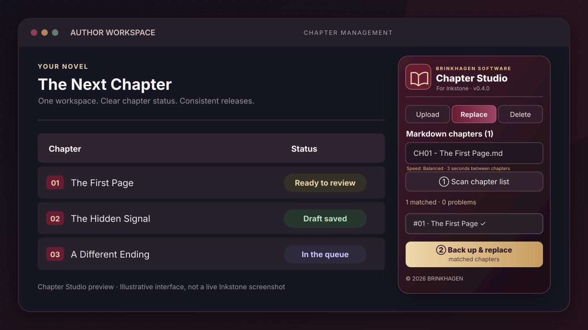

# BRINKHAGEN Chapter Studio

<p align="center">
  
</p>

<p align="center">
  
</p>

<h3 align="center">Write in Markdown. Organize with clarity. Publish on your terms.</h3>

<p align="center">
  A refined browser workspace for authors using <strong>WebNovel Inkstone</strong> — built for chapter imports, drafts, publishing plans, and careful updates to existing stories.
</p>

<p align="center">
  
  
  
  
</p>

<p align="center">
  <a href="#quick-start">Get started</a> &nbsp;·&nbsp;
  <a href="#the-workspace">See the workspace</a> &nbsp;·&nbsp;
  <a href="#publishing-workflows">Explore workflows</a> &nbsp;·&nbsp;
  <a href="https://brinkhagen-chapter-studio.newfinch66.chatgpt.site/">Product website</a>
</p>


<p align="center"><sub>BRINKHAGEN editorial artwork · An illustration of the chapter workflow, not a WebNovel screenshot.</sub></p>

---

## ✦ Why Chapter Studio?

Writing a novel is difficult enough. Moving dozens of chapters between Markdown files and a publishing dashboard shouldn't feel like a second job.

**BRINKHAGEN Chapter Studio** brings the repetitive parts of your Inkstone workflow together in a compact Chrome extension:

- **Import chapters in batches.** Select numbered `.md` files, sort them by chapter number and keep the order predictable.
- **Choose the outcome.** Save drafts, publish immediately, or work through a timed release plan.
- **Plan your cadence.** Configure chapters per day and daily release times, with a schedule preview and CSV export.
- **Revise existing work carefully.** Match chapter numbers, capture original content before changes, and check saved replacements by reopening them.
- **Keep progress locally.** Imported content and queue state stay in your Chrome profile, with pause/resume controls.
- **Move the floating workspace.** Drag the branded top bar wherever it is convenient. Chrome remembers its position, and ↖ resets it to the upper-right corner.
- **Choose a safe pace.** Fast (1.5 s), balanced (3 s), careful (5 s) or a custom 1–15 s pause between chapters. The queue also waits for page/editor readiness.

<table>
  <tr>
    <th>For the author</th>
    <th>What you get</th>
    <th>Current status</th>
  </tr>
  <tr><td>Bulk Markdown upload</td><td>Sequential, chapter-number-aware import</td><td>Available</td></tr>
  <tr><td>Draft workflow</td><td>Save chapters without publishing</td><td>Available · verify on Inkstone</td></tr>
  <tr><td>Publish Now</td><td>Submit chapters for immediate publication</td><td>Assisted automation</td></tr>
  <tr><td>Publish Timer</td><td>Multiple release slots per day, Berlin time planning and known picker support</td><td>Beta · falls back to manual confirmation</td></tr>
  <tr><td>Replace chapters</td><td>Backup-first replacement, TinyMCE integration and saved-content verification</td><td>Beta · live verification in progress</td></tr>
  <tr><td>Delete chapters</td><td>Backup export, typed confirmation and manual Trash verification</td><td>Guarded · never marks a click as confirmed deletion</td></tr>
</table>

> [!IMPORTANT]
> Chapter Studio is in **private beta**. Inkstone's editor and dialogs can change. Test one non-critical chapter, inspect the actual result in Inkstone, and only then process larger batches. Automated tests alone do not establish compatibility with your signed-in account.

## The workspace



<p align="center"><sub>Interface illustration based on the current Chapter Studio controls. It is not a captured session or a claim of verified WebNovel behavior.</sub></p>

The floating panel is designed to stay close to the job at hand:

**Move the panel:** Click and drag the burgundy Chapter Studio header (not its buttons). Release the mouse to remember its location. Use **↖** to return to the default top-right position; use **−** to minimize the panel. The panel stays inside the visible browser window.

| Panel | Purpose |
| :--- | :--- |
| **Upload** | Import new Markdown chapters, save drafts, publish, or schedule. |
| **Replace** | Scan the visible chapter list and start a backup-first replacement. |
| **Delete** | Select exact matches and require a separate safety export and typed confirmation. |
| **Queue status** | View progress, pauses and errors without guessing which chapter ran last. |

## Quick start

**Requirements:** Desktop Google Chrome or a Chromium browser that supports unpacked Manifest V3 extensions, access to your own Inkstone author account, and chapter files in UTF-8 Markdown format.

**Install the current source version (v0.4.0):**

1. From this repository, choose **Code → Download ZIP** and extract it to a permanent folder. Make sure the extension folder contains `manifest.json`.
2. Open `chrome://extensions` in Google Chrome.
3. Enable **Developer mode**, then click **Load unpacked**.
4. Select the extracted folder that actually contains `manifest.json` (the repository root, or `inkstone-uploader-pro` inside the standalone ZIP).
5. Refresh your WebNovel Inkstone chapter management page. The **Chapter Studio v0.4.0** panel should appear.

**Already installed an older copy?** If a panel labelled `Inkstone Uploader PRO Independent v0.2.2` or Chapter Studio v0.3.x is still running, disable or remove the old installation first. Two installations on the same page can interfere with each other. Never start a new batch while an earlier one is still running. After upgrading, clear unfinished old queues and scan again; pre-v0.4.0 jobs cannot be resumed.

**Download note:** GitHub's **Code → Download ZIP** is the source of the current version. The separate product website may still offer an older extension build; check the manifest version before installing.

### Your first 60 seconds

1. Open a novel's chapter page in Inkstone.
2. Select **Upload** and choose **one** `.md` file.
3. Keep **Save as Draft** and **Balanced — 3 seconds** selected.
4. Run the import, then open that draft manually in Inkstone and inspect its title and body.

This single-chapter draft test is the recommended way to validate the extension before using publishing or replacement actions.

## Chapter filenames

Chapter Studio reads each file's number and title from its filename. This is an actual input convention, not a generated identifier.

Use clear sequential names:

```text
CH01 - The Awakening.md
CH02 - The Storm.md
Chapter 003 - A New Rule.md
```

The chapter number determines processing order and matches existing chapter records. The filename without `.md` becomes the chapter title; a matching first Markdown heading is removed from the body.

Example file:

```md
# Chapter 01 - The Awakening

The storm had already crossed the valley when the first signal arrived.

"We're late," Mara said, pulling the door shut behind her.

"Then we'd better stop waiting," Elias replied.

By dawn, nothing about their world would be the same.
```

Keep your chapter filenames unique. If two input files carry the same chapter number, Chapter Studio refuses the ambiguous batch.

## Publishing workflows

### Workflow at a glance

| Your goal | Choose | What happens |
| --- | --- | --- |
| Prepare tomorrow's chapters | **Upload → Save as Draft** | Creates drafts for review. |
| Release an approved chapter | **Upload → Publish Now** | Submits publishing actions through Inkstone. |
| Establish a daily cadence | **Upload → Schedule** | Generates dates and time slots and assists with the native Publish Timer. |
| Correct an existing chapter | **Replace** | Scans, backs up originals, submits edits, then reopens to verify. |
| Remove a chapter | **Delete** | Requires captured originals, exported backup and a typed confirmation. |

### Save as Draft

1. Open the appropriate novel in Inkstone and choose **Upload** in Chapter Studio.
2. Import one or more `.md` files.
3. Select **Save as Draft** and start the import.
4. Review the resulting drafts in Inkstone.

### Publish immediately

Select **Publish Now** only when the imported chapters are approved for immediate release. Check the novel, chapter sequence and any publish confirmation before starting.

### Schedule a release plan


<p align="center"><sub>Scheduling concept artwork · Four publication slots arranged into a repeatable daily rhythm.</sub></p>

1. Select **Schedule — Publish Timer**.
2. Choose the first publication date, chapters per day and the local Berlin times.
3. Review the generated preview and optionally export the plan as CSV.
4. Confirm the date and time in Inkstone when prompted; the extension can pause for manual verification of custom calendar controls.

**Beta behavior:** The extension will try known native and custom calendar/time controls, then require the exact GMT+8 conversion preview before it can auto-confirm. Unsupported pickers stop at a guided manual checkpoint. Never assume a plan in the panel means a chapter was scheduled on Inkstone.

Default example for four chapters per day:

```text
Start date: 2026-10-26
Chapters/day: 4
Release times: 08:00, 12:00, 16:00, 20:00
Timezone: Europe/Berlin
```

| Chapter | Berlin release | Inkstone's converted GMT+8 preview* |
| --- | --- | --- |
| CH01 | 26 Oct 2026 · 08:00 | 26 Oct · 15:00 |
| CH02 | 26 Oct 2026 · 12:00 | 26 Oct · 19:00 |
| CH03 | 26 Oct 2026 · 16:00 | 26 Oct · 23:00 |
| CH04 | 26 Oct 2026 · 20:00 | 27 Oct · 03:00 |

<sub>*Example uses the Berlin daylight-saving offset on 26 October 2026. Always inspect the actual converted preview presented by Inkstone for your release date.</sub>

Inkstone's Publish Timer accepts **local browser time** and displays its automatically converted GMT+8 value. For example, `2026-10-26 08:00` Berlin time is shown as `2026-10-26 15:00 GMT+8` in the converted preview. Enter the Berlin time in the picker, not the converted GMT+8 time.

**Time-zone safeguards:** The scheduler checks that Chrome uses a Berlin-compatible local time zone, rejects dates in the past, requires one unique slot per chapter per day and detects problematic daylight-saving transitions. Custom Inkstone date pickers may still require manual confirmation.

### Replace or delete chapters

For existing chapters, use the guided workflow:

1. Open the relevant chapter list.
2. Import the target `.md` files or select visible chapters for deletion.
3. **Scan** and verify exact chapter-number matches.
4. For **Replace**, click **Back up & replace matched chapters**, then confirm. The extension automatically backs up each original inside Chrome before editing any chapter. It then submits Save/Update, reopens each chapter, and compares the saved title and body before advancing. A mismatch stops the queue.
5. For **Delete**, use **Back up original chapters**, then download the backup file and provide the typed confirmation before deleting anything. After a deletion attempt, **verify the chapter is absent from Published and present in Trash** before selecting **I verified deletion; next**. If the Delete control is unknown, the extension stops and guides you to perform that individual removal manually.

The backup file is an optional external safety copy for replacement. Internally captured backups stay in Chrome's extension storage. To keep a backup even if you uninstall Chrome or the extension, use **Download safety backup** after the originals have been captured.

**Important:** Browser-automation behavior depends on the live Inkstone editor and can change when WebNovel changes its UI. Successful local tests do not prove a chapter was saved on WebNovel. Start with one non-critical chapter and verify it in the Inkstone interface.

Chapter matching is intentionally strict. Missing or duplicate chapter numbers stop the operation rather than risking changes to the wrong chapter. Scanning covers the visible list, so check pagination when working with large novels.

### What happens during a replacement?

1. **Identify:** Each `.md` file is mapped to exactly one chapter number from the visible Inkstone list.
2. **Protect:** The original text and title are captured to local extension storage before any chapter is changed.
3. **Replace:** The title and manuscript text are inserted through the editor (using TinyMCE's own API when present), then Save/Update is submitted.
4. **Reopen:** The chapter is loaded again and compared with the intended title and text.
5. **Stop on disagreement:** A mismatch, missing editor, duplicate number or unexpected dialog pauses the queue for manual inspection.

> [!CAUTION]
> A successful **Save** button click is not the same as a confirmed server-side update. The extension includes a read-back check, but you should still verify chapter content on the live WebNovel site before processing a full book.

## Safety and privacy

The extension runs **inside your Chrome browser** on the supported Inkstone pages. It does not require a BRINKHAGEN server, a separate account, or a paid publishing subscription.

- Chapter files, the job queue and captured originals are stored with Chrome's local extension storage.
- The extension requests access only to supported Inkstone URL patterns and Chrome storage.
- Password collection, external analytics and server-side chapter transfer are not part of the extension.
- Optional backup downloads are local files; keep them somewhere safe if you intend to make destructive edits.
- Deletion is deliberately more restrictive than replacement and requires an external backup plus explicit confirmation.

**Scope:** The extension automates actions inside your existing author session. You remain responsible for selecting the correct book, verifying your material and complying with the platform's publishing requirements.

## Troubleshooting

| Symptom | Likely reason | What to do |
| --- | --- | --- |
| **Replace button is disabled** | The scan has no unique match or the queue is running. | Open **Published**, import numbered `.md` files, click **Scan**, and check `matched` and `problems`. |
| **Chapter opens and closes without changing** | You may be in the backup pass or the editor rejected the Save action. | In v0.4.0 use **Back up & replace matched chapters**, then inspect the status and reopening verification. A paused error is not a successful replacement. |
| **Old PRO panel still appears** | An earlier extension installation is active. | Disable v0.2.x/v0.3.x and reload the page with only Chapter Studio v0.4.0 enabled. |
| **Only 15 chapters are found** | The current Inkstone list may be paginated. | Scan each relevant page and process only chapters visible on that page. |
| **Wrong chapter title** | The filename becomes the title. | Rename the `.md` file to the exact intended title, e.g. `CH01 - Exile.md`. |
| **Scheduling pauses at timer** | Inkstone uses a custom picker or the converted time cannot be verified. | Set the **local** time manually, inspect the converted GMT+8 preview, and confirm inside Inkstone. |
| **Delete paused after clicking** | The extension will not infer that a destructive action succeeded just because a button was clicked. | Check **Published** and **Trash**, then press **I verified deletion; next**. |
| **No Save/Update button detected** | The Inkstone editor UI changed or more than one control matches. | Stop the queue, review the unsaved editor and report the visible status. |

## Frequently asked questions

<details>
<summary><strong>Does it publish my chapters automatically every day?</strong></summary>

It builds a multi-day release plan and can assist with Inkstone's native Publish Timer. Automatic confirmation is limited to recognized controls; custom calendar dialogs can require your input. You do not need to leave your browser open after Inkstone has accepted a scheduled publication, but you should verify each scheduled chapter in Inkstone.
</details>

<details>
<summary><strong>Can it save everything as drafts?</strong></summary>

Yes, **Upload → Save as Draft** is the default delivery mode. Test with one chapter and inspect the saved draft before starting a large batch.
</details>

<details>
<summary><strong>Will it overwrite unrelated chapters?</strong></summary>

The replacement path requires a unique chapter-number match and checks the expected editor before writing. These safeguards reduce the risk but cannot eliminate bugs caused by future Inkstone interface changes. Start small and keep backups.
</details>

<details>
<summary><strong>Do I need to open a JSON file?</strong></summary>

No. Replacement saves originals inside Chrome automatically. A downloadable safety backup is optional for replacement and required for deletion. The downloaded file is a technical restoration record, not something you must edit.
</details>

<details>
<summary><strong>Does it support Patreon uploads too?</strong></summary>

No. This extension currently targets WebNovel Inkstone, not Patreon or other publishing dashboards.
</details>

<details>
<summary><strong>Is it available in the Chrome Web Store?</strong></summary>

Not at this stage. This is a privately distributed, unpacked Chrome extension. Chrome Web Store packaging and distribution are planned work, not shipped features.
</details>

## Roadmap

- [x] BRINKHAGEN branding, iconography and consistent in-page controls
- [x] Multi-file Markdown import and chapter-number ordering
- [x] Draft mode and publishing-plan preview
- [x] Local backup capture and guarded replacement workflow
- [x] Single-start backup-first replacement (v0.3.2)
- [x] Floating panel positioning, persistent placement and reset (v0.3.3)
- [x] Configurable, persisted chapter delay (v0.4.0)
- [x] TinyMCE MAIN-world bridge and safer Delete verification checkpoint (v0.4.0)
- [x] Automated core logic tests and version consistency checks
- [ ] Verified end-to-end Save/Update, timer picker and Delete behavior against the current live Inkstone editor
- [ ] Optional built-in restore action from captured backups
- [ ] More detailed per-chapter success/error log and downloadable execution report
- [ ] Richer chapter preview with metadata and word counts
- [ ] Browser compatibility test matrix and Chrome Web Store distribution review

## Development

```bash
node --check src/core.js
node --check src/content.js
node --check src/editor-bridge.js
node --test tests/core.test.cjs tests/branding.test.cjs tests/editor-bridge.test.cjs
```

The project uses Chrome Manifest V3 with JavaScript and CSS; it does not require a build step or a separate server. Chrome controls are accessed through a content script. The core module isolates chapter parsing and scheduling math for repeatable tests.

```text
assets/                 Brand assets, product illustrations and browser icons
src/core.js             Chapter parsing, matching and release planning
src/content.js          Inkstone workflow and panel logic
src/editor-bridge.js    Limited TinyMCE bridge running in Chrome MAIN world
src/panel.css           BRINKHAGEN visual theme
tests/                  Automated logic and branding checks
.github/workflows/       Continuous integration
manifest.json           Chrome extension manifest
CHANGELOG.md            Version history
```

### Quality gates

| Check | Coverage |
| --- | --- |
| `node --check` | JavaScript syntax validity |
| `tests/core.test.cjs` | Filename parsing, chapter matching and release-time calculations |
| `tests/branding.test.cjs` | Manifest, icon files and expected panel characteristics |
| `tests/editor-bridge.test.cjs` | TinyMCE write and ambiguous-editor refusal |
| `tests/ui-smoke.cjs` | Browser-rendered smoke test when Playwright Chromium is installed |

**Limit:** Passing these checks does not certify that the current Inkstone UI will save or publish content. Live editor behavior still requires targeted validation.

## BRINKHAGEN

<p align="center">
  
</p>

<p align="center"><strong>Thoughtful software. Precise workflows. Beautifully restrained design.</strong></p>

<p align="center">
  <a href="https://brinkhagen-chapter-studio.newfinch66.chatgpt.site/">Product website</a> ·
  <a href="CHANGELOG.md">Changelog</a> ·
  <a href="https://github.com/Brinkhagen/brinkhagen-chapter-studio/issues">Report a problem</a>
</p>

---

<p align="center">© 2026 <strong>BRINKHAGEN</strong> · All rights reserved.<br><sub>BRINKHAGEN Chapter Studio is a third-party utility for authors using Inkstone.</sub></p>
